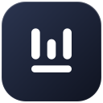
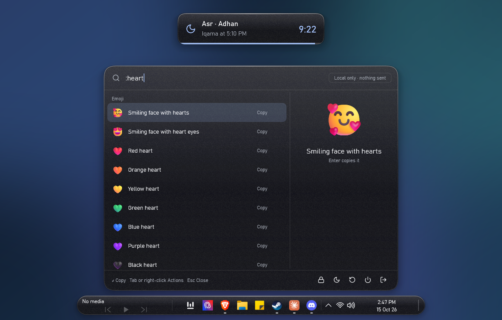
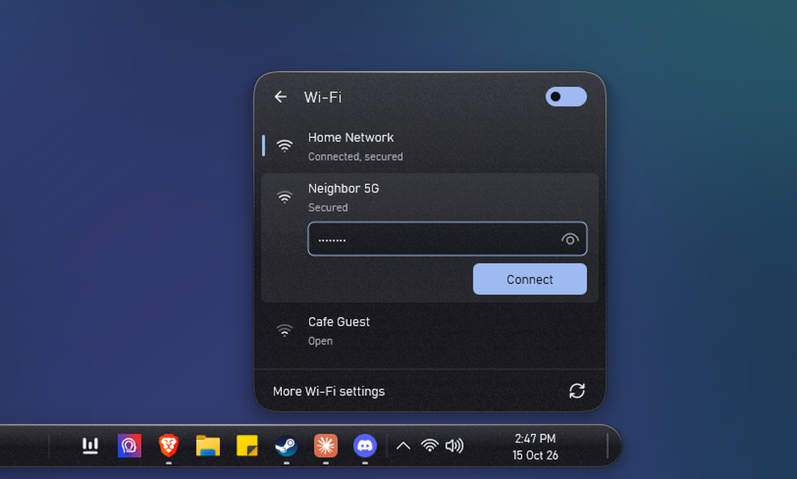
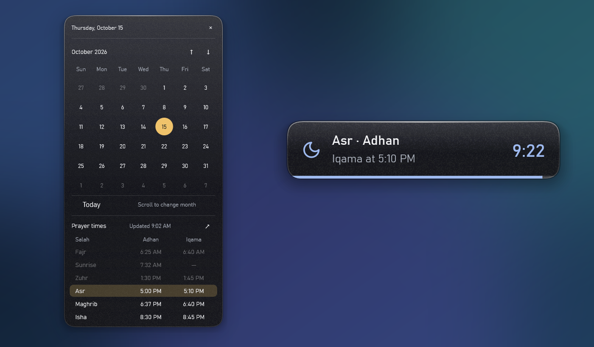
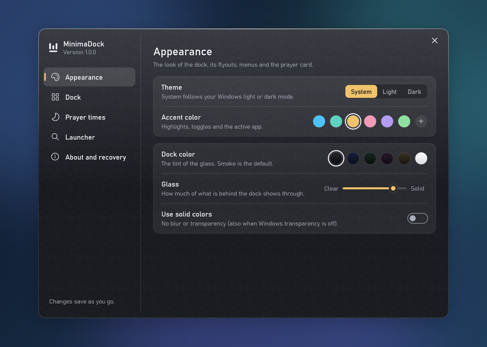
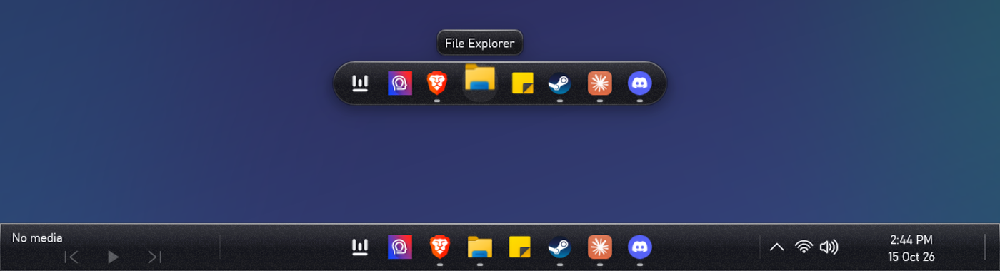

<div align="center">



# MinimaDock

**A calm, glassy dock that replaces the Windows 11 taskbar.**<br>
Your apps, a fast local launcher, media, quick settings, calendar and prayer times, in one small pill.

[](https://github.com/AbdulBasithMohammed/MinimaDock/releases/latest)
[](https://github.com/AbdulBasithMohammed/MinimaDock/releases)
[](#requirements)
[](docs/development.md)
[](https://github.com/AbdulBasithMohammed/MinimaDock/actions/workflows/build.yml)
[](LICENSE)

### [⬇&nbsp; Download for Windows 11](https://github.com/AbdulBasithMohammed/MinimaDock/releases/latest)

<sub>Free and open source · No account · Nothing sent online · Uninstalls in one click</sub>

<br>



</div>

<br>

## ✨ Highlights

<table>
<tr>
<td width="50%" valign="top">

### 🪟 A dock, not a taskbar
A compact glass pill holds your pinned and open apps. Hover and it grows into media controls, quick settings and the clock. It slides away over maximized and full-screen windows, and comes back when you need it.

</td>
<td width="50%" valign="top">

### 🔎 A launcher that stays on your PC
Tap the **Windows key** to search apps, open windows, files and Settings. Do quick sums (`15% of 80`, `5 km in mi`), find emoji (`:heart`), run commands (`>`), or jump to the web (`yt`, `g`, `gh`, `wiki`, `maps`). Nothing you type leaves your PC.

</td>
</tr>
<tr>
<td width="50%" valign="top">

### 🕌 Prayer times built in
Point it at your masjid's website, or let it calculate times for your city or this PC's location, and the clock shows the next prayer. At each Adhan a small card (even over games) counts down to Iqama with a gentle chime. Works with GalaxyStream, Masjidal / Athan+, Mawaqit and most timetable pages.

</td>
<td width="50%" valign="top">

### 🎨 Yours to tune
Theme, accent colour, glass tint and strength, icon size, magnification, motion, 12/24-hour clock, and a **full-width bar** style if you prefer a classic taskbar. Every change applies instantly.

</td>
</tr>
</table>

## 📸 A closer look

<table>
<tr>
<td align="center" width="50%"><br><sub><b>Quick settings</b>: tiles you choose, volume and brightness</sub></td>
<td align="center" width="50%"><br><sub><b>Calendar and prayers</b>: Adhan and Iqama at a glance</sub></td>
</tr>
<tr>
<td align="center" width="50%"><br><sub><b>Settings</b>: right-click the dock</sub></td>
<td align="center" width="50%"><br><sub><b>Two styles</b>: floating pill or full-width bar</sub></td>
</tr>
</table>

## 🚀 Install

1. **Download** `MinimaDock-<version>.zip` from the [latest release](https://github.com/AbdulBasithMohammed/MinimaDock/releases/latest).
2. **Extract** it (right-click > *Extract All*).
3. Double-click **`Install MinimaDock.cmd`**.

That's it. MinimaDock starts right away and every time you sign in. No administrator rights needed.

> [!NOTE]
> MinimaDock is not code-signed yet. Windows may say *"Windows protected your PC"*: choose **More info > Run anyway**. If **Smart App Control** blocks it, the installer stops and changes nothing.

### Updates

MinimaDock checks GitHub once a day. When a new version is out, **Update** appears in the dock's right-click menu and in Settings > About and updates; one click downloads it, checks it and installs it. Nothing installs without you choosing it.

### Uninstall

Double-click **`Uninstall MinimaDock.cmd`**, or go to **Settings > Apps > Installed apps > MinimaDock > Uninstall**. The Windows taskbar comes straight back. Your settings are kept in case you return.

### Requirements

- Windows 11, 64-bit (x64)
- A normal user account (no admin needed)

## ⌨️ Handy shortcuts

| Shortcut | What it does |
| --- | --- |
| <kbd>Win</kbd> | Open the launcher (Win + another key still works as usual) |
| <kbd>Ctrl</kbd> + <kbd>Esc</kbd> | Open the Windows Start menu |
| <kbd>Ctrl</kbd> + <kbd>Alt</kbd> + <kbd>Space</kbd> | Show a hidden dock |
| <kbd>Ctrl</kbd> + <kbd>Alt</kbd> + <kbd>Backspace</kbd> | Bring back the Windows taskbar until you sign in again |
| <kbd>Tab</kbd> / right-click in the launcher | Actions for the selected result |
| <kbd>Shift</kbd> + <kbd>Enter</kbd> | Run the selected app as administrator |

## 🛟 Safe by design

- **Nothing is removed.** Explorer keeps running; MinimaDock only hides its taskbar while it runs.
- **Always recoverable.** The original taskbar state is saved before anything is hidden and restored on uninstall, sign-out, a crash or even a power cut.
- **Self-healing.** If the dock crashes it restarts by itself; if it keeps failing, your Windows taskbar comes back automatically.
- **Private.** Searches stay on your PC. The only internet requests are the prayer-times website you choose (and the widget hosts it names), OpenStreetMap's city search when you press Find or Locate me, and a daily update check on GitHub, which you can turn off.

## ❓ FAQ

<details>
<summary><b>Does it replace Explorer or change system settings?</b></summary>
<br>
No. It installs to <code>%LOCALAPPDATA%\Programs\MinimaDock</code> and adds itself to your sign-in startup. File Explorer, the desktop, Start and notifications keep working. No services, drivers or admin rights.
</details>

<details>
<summary><b>How do I set up prayer times?</b></summary>
<br>
Right-click empty space on the dock > <b>MinimaDock settings</b> > <b>Prayer times</b>, and choose <b>Masjid website</b> or <b>My location</b>. With a website, MinimaDock tries several ways of reading it and checks the times make sense. With My location, search your city or press <b>Locate me</b>; times are calculated on your PC with the method used in your country, which you can change.
</details>

<details>
<summary><b>Windows Smart App Control blocked it. What now?</b></summary>
<br>
Smart App Control only allows apps it trusts, and MinimaDock is a new, unsigned app. The installer detects the block and leaves your PC unchanged. Whether to change Smart App Control is your call; MinimaDock never changes it for you.
</details>

<details>
<summary><b>How do I go back to the normal taskbar?</b></summary>
<br>
For this session: <kbd>Ctrl</kbd> + <kbd>Alt</kbd> + <kbd>Backspace</kbd>, or right-click the dock > <b>Return to the Windows taskbar</b>. To stop it starting with Windows: Settings > About and updates > <b>Start with Windows</b>. To remove it completely: run <b>Uninstall MinimaDock.cmd</b>.
</details>

## 🛠️ Build from source

MinimaDock is native C++20 with Direct2D, DirectWrite and DirectComposition. No frameworks, no runtime to install.

```powershell
cmake --preset msvc-x64
cmake --build --preset release-x64
ctest --preset test-x64
```

A portable LLVM build (`tools\Build-Portable.ps1`), the installer (`tools\Install-MinimaDock.ps1`) and the release packager (`tools\Make-Release.ps1`) are described in [docs/development.md](docs/development.md). For how everything works under the hood (layout, recovery, compatibility and performance), see [docs/how-it-works.md](docs/how-it-works.md).

## 🤝 Contributing

Ideas, bug reports and pull requests are welcome. Start with [CONTRIBUTING.md](CONTRIBUTING.md): it covers building, trying a build safely and how changes get merged and released.

## 📄 License

[MIT](LICENSE) © 2026 AbdulBasithMohammed. Third-party components keep their own licenses; see [THIRD_PARTY_NOTICES.md](THIRD_PARTY_NOTICES.md).

<div align="center">
<br>
<sub>If MinimaDock makes your desktop a little calmer, a ⭐ helps others find it.</sub>
</div>
